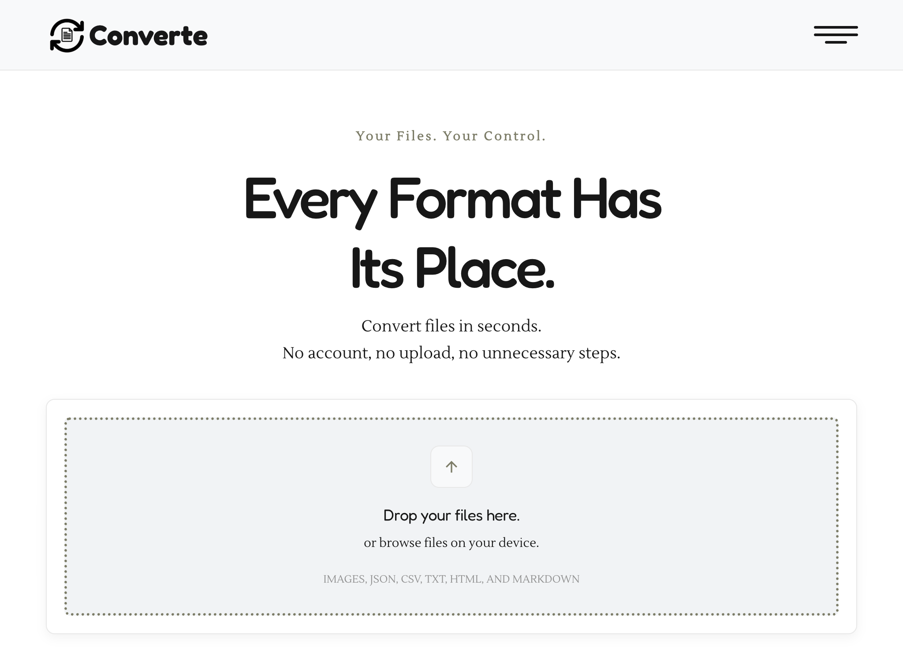
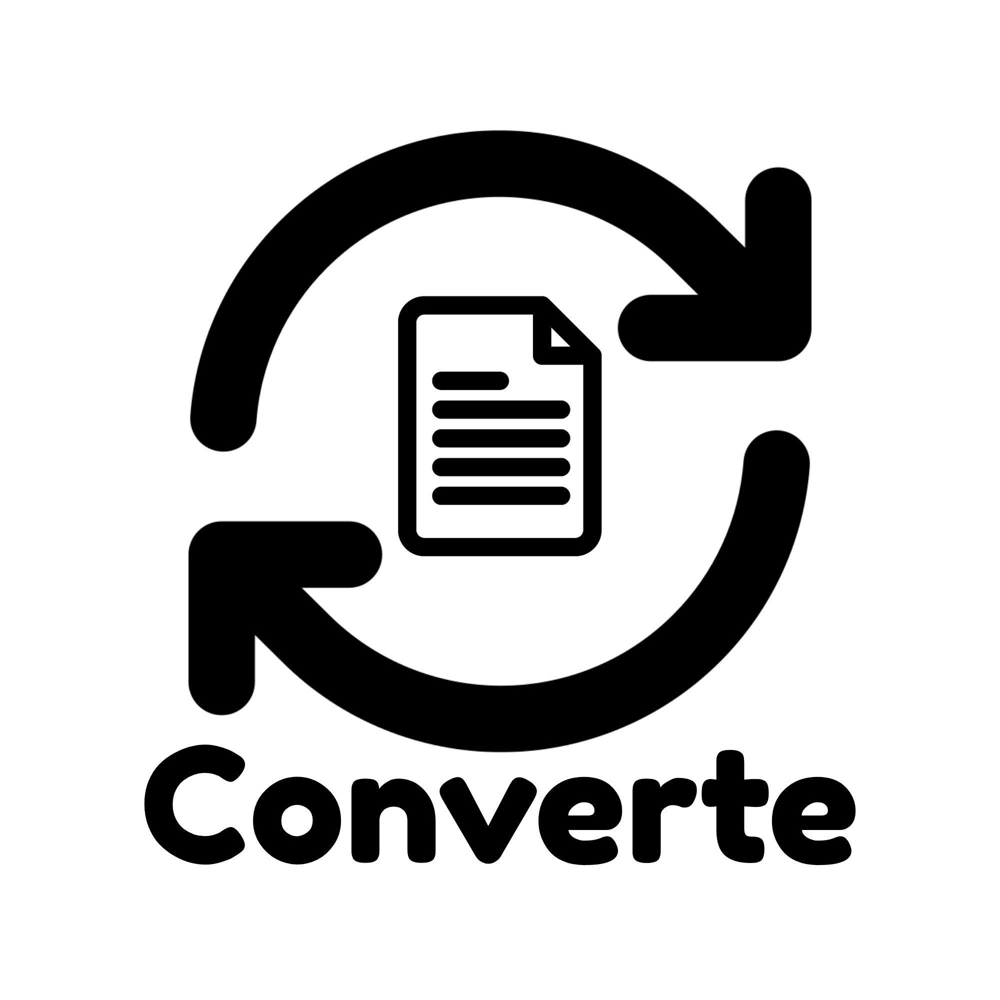
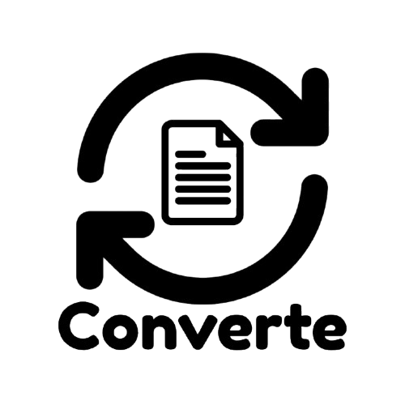

<h1>Converte</h1>

A webapp to convert file, images, videos, and music formats.

<h3>Logos:</h3>

<h3>Favicon:</h3>

This webapp was created using <strong>HTML, CSS, and JAVASCRIPT</strong>. The design is minimal with subtle animations. The fonts used are <strong>Fredoka, and Lustria</strong>. These are rounded sans serif and serif fonts just like the logo. The icon are from <strong>remixicon</strong>.

You can check out the webapp live at:

<a href="https://converte.rojen.name.np" target="_blank">https://www.converte.rojen.name.np</a>